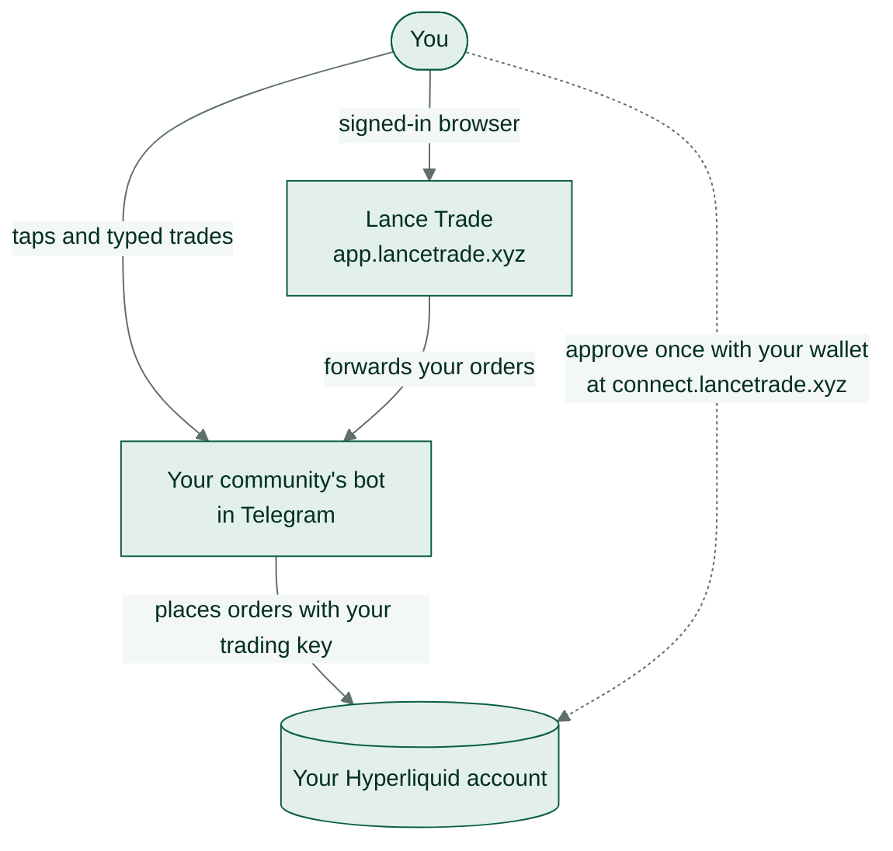

import RiskWarning from "/snippets/risk-warning.mdx";

Lance has four pieces. You only deal with the first three; the fourth is your own account.

| Piece | Where | What it does |
| --- | --- | --- |
| Your community's bot | Telegram | Shows markets and your positions, and places the trades you ask for. |
| The approval page | `connect.lancetrade.xyz` | Where you connect your wallet and approve Lance, once. |
| Lance Trade | `app.lancetrade.xyz` | A trading screen in the browser. It sends your orders through your bot. |
| Your Hyperliquid account | Hyperliquid | Holds your funds and positions. Every trade executes here. |

## When you connect

Your bot makes a trading key just for you and sends you a link to the approval page. There you sign with your own wallet to:

1. **Prove the wallet is yours.** You sign a message that names you and the bot. This moves no funds.
2. **Approve the trading key.** Hyperliquid then lets that key place and close trades and change leverage on your account. It can't withdraw or send funds to another wallet, and it expires after 180 days.
3. **Approve the bot fee.** Hyperliquid then lets Lance charge its fee on each trade placed through the bot.

Your wallet's own keys never leave your wallet. [Connect your wallet](/telegram/connect-wallet) walks through it step by step.

## When you trade

1. You pick a market, a size and a leverage, in Telegram or in Lance Trade.
2. The bot checks the order against your community's rules: allowed markets, the leverage cap and the largest order size.
3. It checks Hyperliquid's order book. If nobody can fill your side within your community's price limit, it says so instead of sending the order.
4. You see a review with the bot fee before you confirm, unless you switched on one-tap trading.
5. The bot places the order on Hyperliquid with your trading key, then shows the fill with Hyperliquid's fee and the bot fee.

## Where the fee goes

The bot fee is collected on Hyperliquid as a builder fee, the one you approved when you connected. Lance shares part of it with the community that runs your bot. Hyperliquid also charges its own trading fee. [Fees](/account/fees) has the numbers.

## Lance Trade holds no keys

Your trading key stays with the bot. Lance Trade signs you in with a one-time link from your bot and forwards each order to it, so the same rules and checks apply on the web as in Telegram. Live prices, charts and order books come straight from Hyperliquid.

<RiskWarning />
