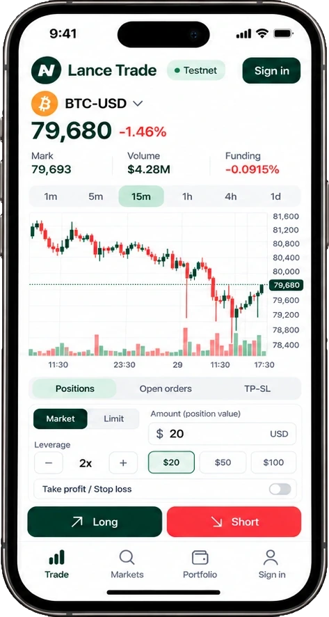

import RiskWarning from "/snippets/risk-warning.mdx";

<Frame caption="Example screen of Lance Trade on a phone.">
  
</Frame>

## The screen

- **Markets:** search crypto perps, see live prices and keep favourites.
- **Chart:** live candles for the market you picked. Your open orders show as dashed lines.
- **Order book and trades:** live from Hyperliquid. Click a price in the book to use it for a limit order.
- **Order panel:** side, market or limit, amount, leverage, and take profit and stop loss.
- **Positions, open orders, trade history, funding and account history**, under the chart.
- **Comments**, beside them on a tablet or desktop: your community's [chart comments](/community/chart-comments).

Drag the edges between the chart, the order book, the order panel and the positions to resize them. Double-click an edge to reset it.

Other pages, from the menu: **Portfolio** (your history, 25 rows a page or 10 to 100, and [Your stats](/account/stats-and-limits)), **Wallets** ([Follow wallets](/telegram/follow-wallets)), **Leaderboard** if your community has it on ([Leaderboard](/community/leaderboard)), and **Learn** ([free lessons](/learn)).

## Market orders

Pick **Long** or **Short**, an amount and a leverage. You can add a take profit and stop loss in the panel, as a trigger price or a gain or loss in %; the bot places them from the fill price. Check the summary, then confirm.

Or switch the panel from **Amount** to **Risk**: say how much you're prepared to lose and where your stop goes, and the panel works out the size that would lose that much there, fees included, within every limit. The stop goes with the order as its stop loss.

## Limit orders

Switch the panel to **Limit** and set a price. **Mid** fills in the current mid price. Then pick how long the order lives:

| Time in force | What it does |
| --- | --- |
| **GTC** (good till cancelled) | Waits on the book until it fills or you cancel it. Priced across the book, it fills straight away at that price or better. |
| **Post only** | Only ever rests on the book, for the lower maker fee. If it would fill straight away, Hyperliquid cancels it and nothing trades. The panel warns you before you send it. |

Some limits apply to limit orders:

- The price must be within 50% of the current mid.
- A limit order can't be priced further through the book than your community's price limit. It would fill straight away, like a market order.
- You can't attach a take profit or stop loss to a limit order. Set them from **Positions** once it fills.

The summary shows the exact size sent, and Hyperliquid's fee: the maker fee (0.015%) when the order rests, or the taker fee (0.045%) when it would fill at once, plus the bot fee. The confirm dialog sends exactly the order it shows. If the order changes while the dialog is open, the dialog closes.

## Open orders

Resting orders show under **Open orders**, with a **Cancel** button each, and as dashed lines on the chart. When one fills later, it shows in **Trade history** and Lance Trade raises a notice.

## Manage your positions

- **Close all** closes every position, or a share of each. Tick positions first and it becomes **Close selected**. You confirm before anything closes.
- **Cancel all**, in the **Open orders** header, cancels your resting orders.
- A position's ⋯ menu has **Stop to breakeven** (moves your stop loss to entry plus fees both ways) and **Set price alert**.

Each close shows your net result after fees and funding. See [Net PnL on every close](/account/stats-and-limits#net-pnl-on-every-close).

## Chart tools

- **Drawings:** trend lines, rays, horizontal and vertical lines, channels, rectangles, Fibonacci retracements, price and time ranges, long and short position tools, and text. Up to 200 drawings, saved on your device. The toolbar has a magnet, and can lock or hide all drawings.
- **Indicators:** Volume, SMA, EMA, Bollinger Bands, VWAP, RSI, MACD, Stochastic RSI and ATR, up to 12 at a time.
- **Price alerts:** the 🔔 bell beside the price. Waiting alerts show as dashed lines. See [Price alerts](/telegram/alerts#price-alerts).

Press **Cmd-K** (**Ctrl-K** on Windows) to jump to a market, page, tool or setting by typing. Nothing in it places an order.

## One leverage per market

Hyperliquid keeps one leverage per market. With a position or resting orders in a market, a new order there must use the same leverage. The panel starts at that leverage when it can. Otherwise it explains why before you send, and offers a **Use Nx** button where that fixes it.

## The same rules as your bot

Your community's markets, leverage cap, order sizes and risk limits apply in Lance Trade too, as do the order book checks and [your own limits](/account/stats-and-limits#your-limits). Defaults such as order size and leverage are shared with the bot's [Settings](/telegram/settings).

If your community's owners pause new orders, you can still close positions, change take profits and stop losses, and cancel orders. If Lance pauses the whole bot, you can still close positions and cancel orders in Lance Trade. You can always manage your positions directly on Hyperliquid with your wallet.

<RiskWarning />
