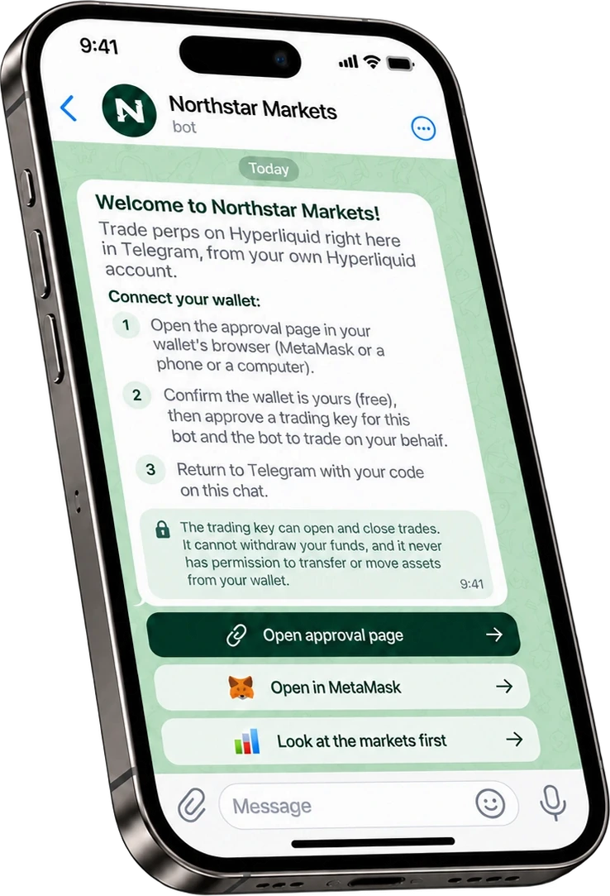

import RiskWarning from "/snippets/risk-warning.mdx";

You connect once. After that, every trade is a tap or a typed line in Telegram.

## Your own wallet or a Lance wallet

When you're ready to trade, tap **⚡ Set up trading** in your community's bot (or any trade button). You get two choices:

- **🦊 Connect my own wallet**: approve the bot from MetaMask or another wallet you already use. Your money stays in your wallet. This is the most secure way, and the one we recommend for serious trading. This page walks through it.
- **⚡ Create a Lance wallet**: a new wallet for the bot that only your phone's lock opens, with no wallet app needed. See [Lance wallet](/account/lance-wallet).

## What you need

- **A wallet** such as MetaMask: a browser extension on a computer, or a wallet app on a phone (see below).
- **Your main Hyperliquid wallet.** Not an API wallet, a vault or a sub-account.
- **A wallet that has used Hyperliquid.** If Hyperliquid has never seen the wallet, the page asks you to deposit first.
- **A regular wallet**, not a smart-contract wallet. Smart-contract wallets can't sign in a way the bot can check.

## Steps

<Steps>
  <Step title="Open the approval page">
    In your community's bot, tap **🔗 Open approval page**. On a phone with MetaMask, you can tap **🦊 Open in MetaMask** instead: it opens the page inside MetaMask's own browser, where your wallet is available.

    The link opens `connect.lancetrade.xyz`. If the address is anything else, stop.

    On a phone, a wallet only works in its own app's browser. If the page finds no wallet, it offers to reopen itself in **MetaMask**, **Trust Wallet**, **Coinbase Wallet**, **OKX Wallet** or **Bitget Wallet**, and gives you the link to copy.
  </Step>
  <Step title="Check who the link is for">
    Before asking for any signature, the page shows who the link is for, for example "This link is for @alice in Northstar Futures". If it isn't your Telegram username, close the page.
  </Step>
  <Step title="Connect your wallet and sign">
    The page asks only for what isn't in place yet. The first time, that's three signatures:

    1. **A message naming you and the bot.** It proves the wallet is yours and moves no funds.
    2. **The trading key.** Lets the bot place and close trades for you.
    3. **The bot fee.** Lets Lance charge its fee on trades placed through the bot.
  </Step>
  <Step title="Go back to Telegram">
    When the page says you're all set, tap **Back to Telegram**. The bot checks your approvals on Hyperliquid and connects your wallet.

    If Telegram doesn't open, the page shows a one-time code such as `ABCD-EFGH`. Send it to your bot yourself. The code works for 60 minutes and only from your own Telegram account.
  </Step>
</Steps>

<Frame caption="Example screen. Your community's bot shows its own name and may look slightly different.">
  
</Frame>

## What you approve

| Approval | What it allows | What it doesn't allow |
| --- | --- | --- |
| **Trading key** | Placing and closing trades, setting take profits and stop losses, and changing leverage on your account. | Withdrawing funds or sending them to another wallet. It also stops working after 180 days. |
| **Bot fee** | Lance charging its bot fee on each trade placed through the bot, up to the approved rate. | Any charge on trades you place elsewhere. |

[How access works](/safety/how-access-works) explains the trading key in full.

## Links expire

An approval link works for 30 minutes, and stops working once you've approved or the bot gives you a newer one. An expired page offers **Get a fresh link**, which takes you back to the bot. You can also send `/start connect` to the bot.

<Note>
  Lance isn't available in some countries. From one of them, the approval page says so instead of asking you to connect. See [Restricted regions](/legal/restricted-regions).
</Note>

<Warning>
  Never forward your approval link or the one-time code. The bot only connects the wallet that signed, and only for a code from the Telegram account the link was made for. Even so, keep both to yourself.
</Warning>

<RiskWarning />
